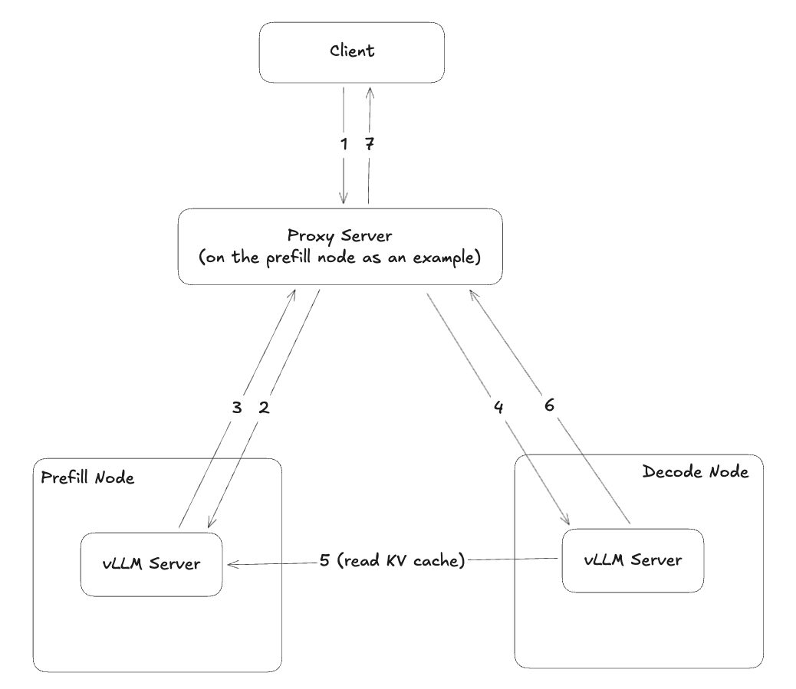

# Disaggregated Inference on vLLM Neuron

This guide provides a step-by-step runbook for setting up and running Disaggregated Inference (DI) on vLLM Neuron using a 1P1D setup across two nodes. Note this is just to illustrate an example setup, while the DI implementation is flexible to support other types of setups.

## Prerequisites

- Two Trn2 nodes reserved for the 1P1D DI setup
- Neuron SDK
- vLLM Neuron and its vLLM plugin

## Architecture Overview



### Components

#### 1. Client

Sends a standard OpenAI/vLLM-style request (prompt, parameters) and expects a streaming/non-streaming completion response.

#### 2. Proxy Server (Control Plane / Request Router)

Sits between client and the model servers. Key responsibilities include:

- Routing requests to prefill and decode nodes
- Tracking request lifecycle (request_id, session, tokens generated)
- Handling streaming back to client

> **Note:** The proxy server can be colocated with the prefill/decode node for reduced latency, but it remains logically independent.

#### 3. Prefill Node (vLLM Server)

Handles the model forward pass over the entire prompt:

- Processes prompt tokens in large parallel compute operations
- Produces KV cache for each layer/head

#### 4. Decode Node (vLLM Server)

Manages iterative decoding:

- Performs attention using existing KV cache for each new token
- Produces next token(s) repeatedly

### Request Flow

#### (1) Client → Proxy

Client sends inference request containing:

- `prompt`/`messages`
- Sampling parameters (`temperature`, `top_p`, `max_tokens`, etc.)
- Optional `stream=True` flag

#### (2) Proxy → Prefill vLLM Server

Proxy forwards the request to the prefill server, which:

- Tokenizes and runs forward pass on the prompt
- Creates the per-request KV cache (the expensive computational artifact)

#### (3) Prefill vLLM Server -> Proxy

Prefill completes and send completion signal back to Proxy server.

#### (4) Proxy → Decode vLLM Server

Proxy prepares the decode side by:

- Creating a decode session/request slot
- Instructing decode node to initiate KV transfer

#### (5) Decode vLLM Server → Prefill vLLM Server (KV Transfer)

**This is the key disaggregation step.** Decode reads KV cache blocks on Prefill.

#### (6) Decode vLLM Server → Proxy (Token Stream)

Decode server generates tokens and streams results back to proxy:

#### (7) Proxy → Client

Proxy forwards output to client.

## Setup Instructions

Set up the vLLM Neuron development environment by following the instructions in the [vLLM Neuron setup guide](https://awsdocs-neuron.readthedocs-hosted.com/en/latest/vllm-neuron/docs/getting-started/setup-guide.html).

## Server Configuration

### 3. Prefill Node Setup

On the **prefill node**, perform the following steps:

#### 3.1 Start the Prefill VLLM Server

```bash
PREFILL=1 ./server.sh <prefill-host> <decode-host>
```

#### 3.2 Start the Proxy Server

```bash
PROXY=1 ./server.sh <prefill-host> <decode-host>
```

### 4. Decode Node Setup

On the **decode node**, start the decode VLLM server:

```bash
./server.sh <prefill-host> <decode-host>
```

## Testing the Setup

### 5. Verification

Wait for all VLLM servers to be up and running. Once ready, you can send a test request to the proxy server to verify it generates correct results:

```bash
curl -s http://localhost:8000/v1/completions \
  -H "Content-Type: application/json" \
  -d '{
    "model": "meta-llama/Llama-3.1-8B-Instruct",
    "prompt": ["a KV cache is"],
    "max_tokens": 200,
    "temperature": 0
  }'
```

## Troubleshooting

- Ensure all servers are properly started before sending test requests
- Verify network connectivity between the prefill and decode nodes
- Check server logs if requests fail or return unexpected results
